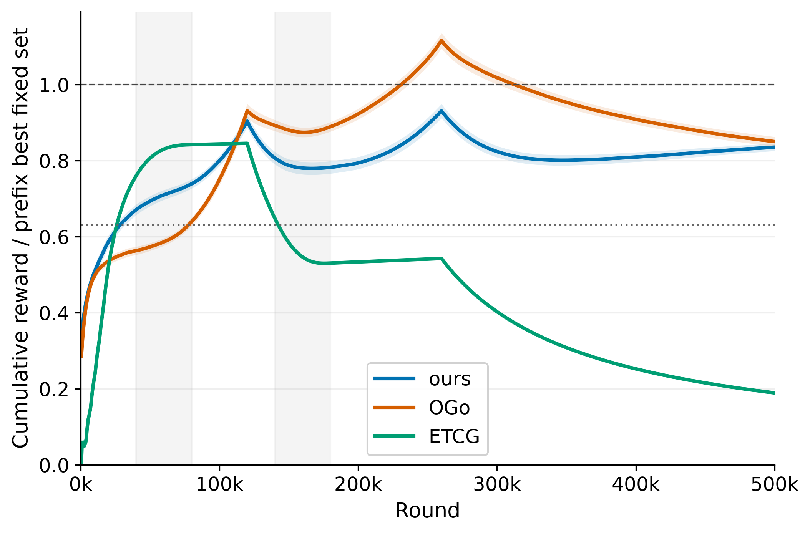
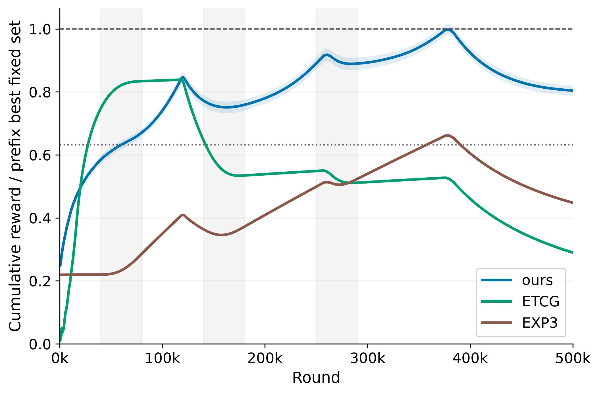

We compare our practical FTPL variant with existing methods under cardinality and graphic matroid constraints. Each experiment uses **500,000 rounds and 80 paired test seeds**. Parameters are selected on eight separate development seeds.

## Shared setting

Each round uses a weighted coverage function:

$$
f_t(S)=\frac{1}{Z}\sum_{e\in\bigcup_{i\in S}C_i}w_{t,e}.
$$

Here $S$ is the selected set of items or graph edges, and $C_i$ is the fixed set of features covered by element $i$. Each covered feature contributes only once, even if several selected elements cover it. Nonnegative weights make every $f_t$ monotone submodular.

Each experiment has several pairwise disjoint target bases $B_r$. At target $r$, the mean of an element's private-feature weight is 1 if the element belongs to $B_r$, and 0.005 otherwise. The shared-feature means specified below remain constant. Each $B_r$ is the unique optimal set for its corresponding mean-weight objective.

Weights are randomized independently across features and rounds:

$$
w_{t,e}=\mu_{t,e}\left[1+0.02 clip(G_{t,e},-3,3)\right],
\qquad G_{t,e}\sim\mathcal N(0,1).
$$

Before clipping, the standard deviation is 2% of the mean; clipping limits fluctuations to $\pm6\%$. This randomness applies on **every round**, including periods with fixed means. A fixed normalizer $Z=1.00001\times1.06\sum_e\mu_{t,e}$ keeps $f_t(U)<1$ for the entire ground set $U$. The total feature mean is constant over time, so $Z$ is constant within each experiment. Methods share the same function sequence for each seed; the targets, weights, and drift schedule are not revealed to them.

### Smooth changes in the objective

Both experiments start at $B_0$. During a transition from target $a$ to target $b$, the mean vector is $(1-\lambda(u))\mu^{(a)}+\lambda(u)\mu^{(b)}$, where $u$ runs from 0 to 1 across the interval and $\lambda(u)=(1-\cos(\pi u))/2$. Between transitions, the mean vector stays at the most recently reached target.

| Round interval | Cardinality | Graphic matroid |
|---|---|---|
| $[40{,}000,80{,}000)$ | $B_0\to B_1$ | $B_0\to B_1$ |
| $[140{,}000,180{,}000)$ | $B_1\to B_2$ | $B_1\to B_2$ |
| $[250{,}000,290{,}000)$ | Hold $B_2$ | $B_2\to B_3$ |

Thus, cardinality uses three targets and two transitions, while the graphic experiment uses four targets and three transitions. Round intervals and element indices in this document are zero-based; intervals exclude the right endpoint.

Curves show cumulative reward divided by the reward of the **best fixed feasible set** for the same prefix, including all exploration rounds. Each curve averages the 80 seed-specific ratios. Shading shows pointwise 95% confidence intervals; gray bands mark drift intervals. Ratios can exceed one because the comparator uses a fixed set.

## Cardinality constraint

**Feasible sets.** The ground set consists of $n=20$ items, and the only constraint is $|S|\le k=5$. There are $\binom{20}{5}=15{,}504$ full-rank sets.

**Coverage features.** Item $i$ covers its own private feature and the shared topic of group $\lfloor i/4\rfloor$. The groups are $\{0,1,2,3\}$, $\{4,5,6,7\}$, and so on. This gives 20 private features and five shared topics, each topic having mean weight 0.03. The groups define coverage overlap only: selecting multiple items from the same group is feasible, and there is no per-group quota.

**Target optima.** Each target contains one item from each coverage group:

| Target | Selected item indices |
|---|---|
| $B_0$ | 3, 5, 9, 14, 17 |
| $B_1$ | 0, 6, 8, 15, 19 |
| $B_2$ | 2, 4, 10, 13, 18 |

**Compared methods:** **ours**, **OGo**, and **ETCG**

[PDF](figures/cardinality.pdf)

## Graphic matroid

**Graph and feasible sets.** Here $n=30$ counts edges, and $k=6$ is the matroid rank. The graph has seven vertices: two complete four-vertex blocks on $(0,1,2,3)$ and $(0,4,5,6)$ share vertex 0. Within each block, the six underlying edges, in local order $(01,02,03,12,13,23)$, have respectively $(3,3,3,2,2,2)$ parallel copies, giving 15 physical edges per block.

A selected edge set is feasible exactly when it is a forest. Both ordinary cycles and two-edge cycles formed by parallel copies are forbidden. A base has six edges and consists of one spanning tree in each block. Each block has 352 forests and 243 spanning trees, giving **123,904 feasible forests**, including partial and empty forests, and **59,049 bases**.

**Coverage features.** Each physical edge covers its own private feature, the topic of its underlying edge, the two triangle features corresponding to triangles containing its endpoints, and its block's feature:

| Feature type | Number | Mean weight at a target |
|---|---:|---|
| Private physical-edge features | 30 | 1 on the target base; 0.005 otherwise |
| Underlying-edge topics | 12 | 0.03 |
| Triangle features | 8 | 0.01 |
| Block features | 2 | 0.01 |

There are 52 features in total. Parallel copies share the topic, triangle, and block features but have distinct private features.

**Target optima.** In each block, the four targets use stars with different centers, with distinct physical copies assigned whenever an underlying edge occurs in two targets. The resulting four bases are pairwise disjoint. Physical edges are indexed consecutively by block, then by the underlying-edge order above, then by copy: indices 0–14 belong to the first block and 15–29 to the second.

| Target | Selected physical-edge indices |
|---|---|
| $B_0$ | 6, 12, 14, 15, 25, 27 |
| $B_1$ | 1, 5, 7, 22, 26, 29 |
| $B_2$ | 3, 9, 13, 17, 19, 23 |
| $B_3$ | 2, 10, 11, 20, 24, 28 |

**Compared methods:** **ours**, **ETCG** with feasible greedy insertions and paper-prescribed $m=124$, and **EXP3**. EXP3 treats every feasible forest as a separate arm, using the classic update with a tuned exploration rate; feedback is not shared between arms.

[PDF](figures/graphic.pdf)

## Results

Mean final cumulative reward ratios:

| Constraint | ours | OGo | ETCG | EXP3 |
|---|---:|---:|---:|---:|
| Cardinality | 0.835 | 0.850 | 0.189 | — |
| Graphic matroid | 0.804 | — | 0.290 | 0.448 |
